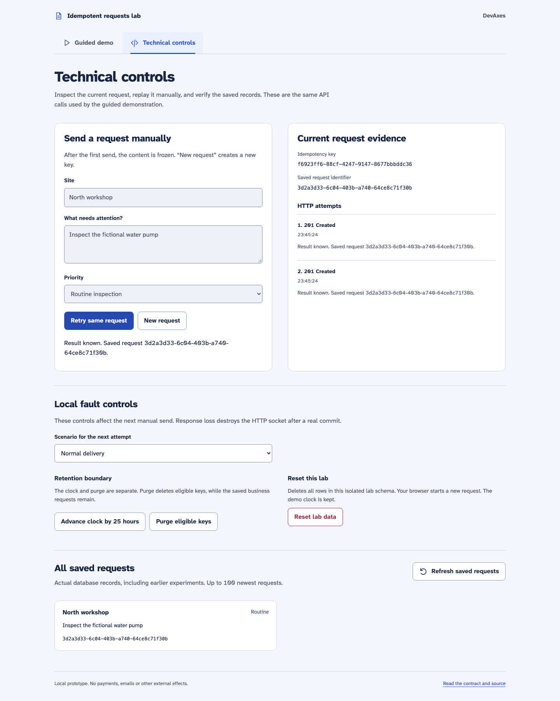

# Idempotent requests lab

A technician sends an intervention request, but the connection drops before the
response arrives. Retrying should recover the saved request rather than create a
second one. This lab makes that failure visible with a NestJS API, PostgreSQL and a
React interface that keeps the same key between attempts.

This is a **local, limited prototype** using fictional maintenance requests. It
explores a bounded database guarantee, not universal exactly-once delivery. There
are no payments, emails, external effects or production deployment.



Two attempts, one saved request. The ledger shows actual responses and the list
below reads PostgreSQL. See the [demo protocol](docs/demo.md) and
[verification record](docs/verification.md) for the examined revision and limitations.

## What to observe

- One key and the same normalized content replay the original 201 status and JSON body.
- Concurrent calls, including two API instances, create one intervention.
- Changing content under a retained key returns 409 without creating another object.
- A pre-commit failure leaves no partial writes. Losing the response **after commit**
  leaves a saved success that the next attempt recovers.
- The browser preserves its key and content across reloads. A new intention gets a
  new key, even when its content is identical.
- Keys stay usable until explicit purge, at least 24 hours after recorded completion.
  Reusing a purged key can create another intervention.

The [contract](docs/contract.md) defines normalization, error handling, retention and
concurrent wait limits. The [architecture](docs/architecture.md) shows the transaction
and lost-response sequence.

## Prerequisites

Use Node **24.13.0**, pnpm **10.34.5**, Git, Docker Engine and Docker Compose v2.
The verified environments are macOS arm64 and the Ubuntu 24.04 CI runner. Other hosts
are not claimed as tested. Installation downloads packages, the PostgreSQL image and
Chromium; the running lab needs no external service, account or paid subscription.

PostgreSQL **17.6** is pinned by multi-platform image digest. Direct dependencies are
exact versions: NestJS **11.2.7**, React **19.3.1**, Vite **7.3.7**, pg **8.23.1**,
Zod **4.6.7**, TypeScript **5.9.3** and Playwright **1.64.1**. The committed
`pnpm-lock.yaml` pins transitive resolution. CI actions use commit hashes. OS images,
Docker itself, package download availability and system fonts can still change.

## Set up and build

Run these commands from the repository root, with Docker running:

```sh
git clone https://github.com/FredDevAxes/idempotent-requests-lab.git
cd idempotent-requests-lab
nvm install
nvm use
npm install --global pnpm@10.34.5
pnpm install --frozen-lockfile
cp .env.example .env
docker compose up -d --wait
pnpm build
pnpm db:migrate
```

`nvm install` reads `.nvmrc`. If you do not use nvm, install Node 24.13.0 by your
usual method before installing pnpm. Migrations create only the lab schema in the
dedicated database and can be rerun. No seed data is required.

Compose exposes PostgreSQL on **127.0.0.1:55432** using trust authentication for this
isolated local database. The example contains no real credentials. Do not reuse this
setup for a shared database. Keep `.env` outside Git; provide real credentials through
the environment if you adapt the database connection.

## Run the demonstration

```sh
LOCAL_DEMO=true pnpm dev
```

Open **http://127.0.0.1:5173**. The API listens on 127.0.0.1:3100. To watch the
response-loss experiment:

1. Open **Technical demonstration** and choose **Lose the response after commit**.
2. Send the default fictional request. The result becomes unknown while one record
   appears in **Saved requests**.
3. Reload the page. The key and frozen content stay the same.
4. Select **Normal delivery** and click **Retry same request**. The stored identifier
   is confirmed and the list still contains one request.

After the reload the scenario defaults to Normal delivery. The optional command
below runs the same HTTP-level experiment against the already running API:

```sh
pnpm demo:cli
```

It prints observed identifiers and fails if the lost response did not leave a
persisted success. It adds one fictional request and keeps its key for the retry.
The [full protocol](docs/demo.md) also covers rollback, concurrency, conflicts and purge.

Use **New intention** to unlock the form and create another request. **Reset lab data**
requires confirmation and removes only rows in the isolated lab schema. Advancing
the demo clock does not purge automatically; use **Purge eligible keys** separately.

Stop with Ctrl+C. Normal mode is:

```sh
LOCAL_DEMO=false pnpm dev
```

Fault headers are rejected and all `/demo` routes return 404. `NODE_ENV=production`
also disables these tools even when `LOCAL_DEMO=true`. The standalone API uses the
same default. Demo controls have no authentication and are intended for a trusted
local workstation only.

## Run tests and checks

Keep Docker PostgreSQL running. Install the locked browser once:

```sh
pnpm exec playwright install chromium
pnpm check
```

On Linux, use `pnpm exec playwright install --with-deps chromium` to install required
system libraries. `pnpm check` runs formatting, ESLint, types, builds and every test:

```sh
pnpm format:check
pnpm lint
pnpm typecheck
pnpm build
pnpm test:unit
pnpm test:integration
pnpm test:browser
```

`pnpm format` applies formatting. Root ESLint covers both apps, the contracts package
and JavaScript test/tooling files; each app has its own TypeScript/build target.
Unit and integration tests run on the compiled API. Browser tests run the built web
app with Vite preview, not mocked successes. The detailed risk matrix is in
[docs/testing.md](docs/testing.md).

Tests create isolated schemas and check database row counts after their scenarios.
Integration launches independent API instances and a child process for restart tests.
Browser tests reserve ports **3101** and **5174**, reset their own data between cases
and drop their isolated schema on shutdown. Do not run two browser suites together,
and do not point test configuration at a shared service.

The lost-response test intentionally produces a Vite `socket hang up` message.
That is the injected failure, followed by a verified replay. Zod's pure-comment
annotations may produce harmless build warnings. Neither warning means a test was skipped.
Test traces and reports are written under ignored `test-results/`.

The [GitHub workflow](.github/workflows/check.yml) runs these same checks on every
PR and main push, with real PostgreSQL and Chromium. See the verification record
for runs actually observed; workflow configuration alone is not evidence of a pass.

## Repository map

| Path                 | Responsibility                                                            |
| -------------------- | ------------------------------------------------------------------------- |
| `apps/api`           | NestJS routes, explicit SQL transaction, demo hooks and migrations        |
| `apps/web`           | React form, saved client intention, attempt ledger and database list      |
| `packages/contracts` | Shared validation and types; CommonJS for API, TypeScript source for Vite |
| `tests`              | Unit, real PostgreSQL/HTTP and Chromium suites                            |
| `scripts`            | Local launch, isolated browser server and command-line demonstration      |
| `docs`               | Contract, architecture, risk matrix, review and observed evidence         |

pnpm workspaces coordinate these linked apps; an additional orchestrator would add
little at this size. Root commands are the supported reproduction path. App-specific
build commands are `pnpm --filter @lab/api build` and `pnpm --filter @lab/web build`
after `pnpm --filter @lab/contracts build`.

## Limits

One browser session stores one active intention; use a single tab and preserve local
storage. Clearing storage or intentionally changing a key loses the replay guarantee.
The API has no identity or tenant scope, authentication, rate limiting, pagination
beyond the newest 100 records, or external-effect coordination. Key hashes assume
SHA-256 collision resistance. Time-based retention assumes reasonable wall-clock
synchronization in normal mode. There is no automatic background purge.

Chromium is the automated browser target. Keyboard, contrast, reduced motion and
200% text/reflow checks do not establish complete screen-reader or WCAG certification.
VoiceOver, Firefox, WebKit and deployed infrastructure remain unverified. This lab
is not a performance benchmark or production service.

## License and credits

[MIT](LICENSE), copyright 2026 Frédéric Raimondi, covers the original code in every
workspace package. All package manifests declare MIT. [Third-party notices](docs/third-party.md)
list dependency licenses, which retain their own terms. Screenshots come from this
lab with fictional data; fonts use the host system. No client assets or internal
personal-branding notes are included.
