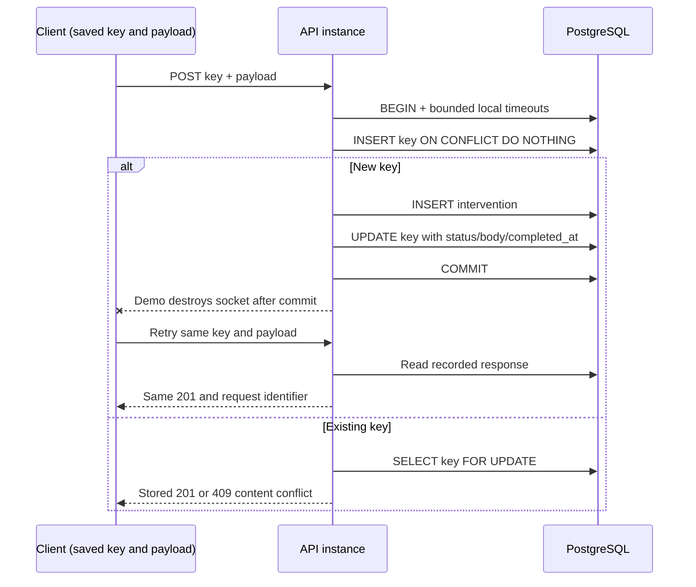

# Architecture and decisions

pnpm coordinates two TypeScript apps and a small contract package. NestJS owns HTTP;
React/Vite owns the demo. Shared Zod validation supplies normalized types. No extra
monorepo orchestration or ORM is needed for two apps and one explicit transaction.
SQL remains visible so the lock and commit boundaries can be inspected.

## Durable transaction

The unique primary key arbitrates even between API processes. At READ COMMITTED,
ON CONFLICT waits for the competing insert; the subsequent statement sees the committed
row. SELECT FOR UPDATE protects replay from an overlapping purge. If a purge deletes
the row between those statements, respond 503 and let the caller retry. This keeps
recovery bounded without a recursive retry loop. The business object is retained
independently of the key. Purge has the same lock/statement bounds.

A connection is released in `finally`. COMMIT errors are treated as uncertain, never
as proof of rollback. Retrying resolves the outcome using the stored key. The clock
is sampled at transaction completion; normal operation uses wall time, while tests
advance a controlled clock without sleeping 24 hours.

Fault hooks pause **after writes and before commit**, announce arrival at a barrier,
and resume only when released. A 10-second watchdog prevents forgotten demo gates
from keeping a transaction open indefinitely. Tests verify visibility from a separate
connection before release, and use pg_stat_activity to observe a waiting contender.
The lost-response hook destroys the real HTTP socket after commit, not a UI message.

## Guided interface

The frontend integrates a scenario presentation and a collapsible technical panel. PRODUCT.md
records the confirmed accompanied-use scenario. DESIGN.md describes the shipped
visual system; the development-only direction contract is never imported by the app.

The guide keeps a lesson, request reference, phase, initial saved-record observation
and first request identifier with the existing client session. Its primary action
sends real HTTP requests and its server panel reads PostgreSQL through the API.
A unique fictional site reference scopes observations to one experiment while keeping
older records. Conclusions check the expected outcome, row count and relevant identity;
a failed read never becomes zero. Two keys represent a separate-request exercise.

The original session format remains valid because guide metadata is optional. Starting
a new experiment is explicit; the initial render does not erase an earlier key or draft.
The technical panel starts collapsed, closes on scenario navigation, and scopes its
primary evidence to the active scenario. Its Advanced tools disclosure retains manual
inputs, faults, HTTP attempts, retention and confirmed reset. Scenario selection uses
URL fragments. Browsing scenarios preserves the current intention until another
experiment is explicitly started; navigation controls are disabled during a send.

Atkinson Hyperlegible Next is served locally from a pinned Fontsource package under
OFL-1.1. The comparison stage uses runtime geometry and authored icon-size SVG paths;
no generated or client-sourced raster asset is included in the interface.

## Sources and versions examined

Versions are fixed in package manifests, `.nvmrc`, the lockfile, Compose and CI.
Registry metadata was checked before installation; this lab deliberately uses NestJS 11
and Vite 7 rather than changing major versions during implementation.

- [Node 24.13.0 LTS](https://nodejs.org/en/blog/release/v24.13.0)
- [NestJS databases](https://docs.nestjs.com/techniques/database)
- [Vite prerequisites](https://vite.dev/guide/)
- [pnpm workspace support](https://pnpm.io/workspaces)
- [PostgreSQL 17 INSERT / ON CONFLICT](https://www.postgresql.org/docs/17/sql-insert.html)
- [PostgreSQL locks](https://www.postgresql.org/docs/17/explicit-locking.html)
- [Playwright setup](https://playwright.dev/docs/intro)

Authentication and tenant-bound keys would be needed for a shared service. External
effects would require additional design (for example a transactional outbox); this
transaction alone does not protect them. No performance benchmark is claimed.

- [Atkinson Hyperlegible Next / Fontsource](https://fontsource.org/fonts/atkinson-hyperlegible-next)
