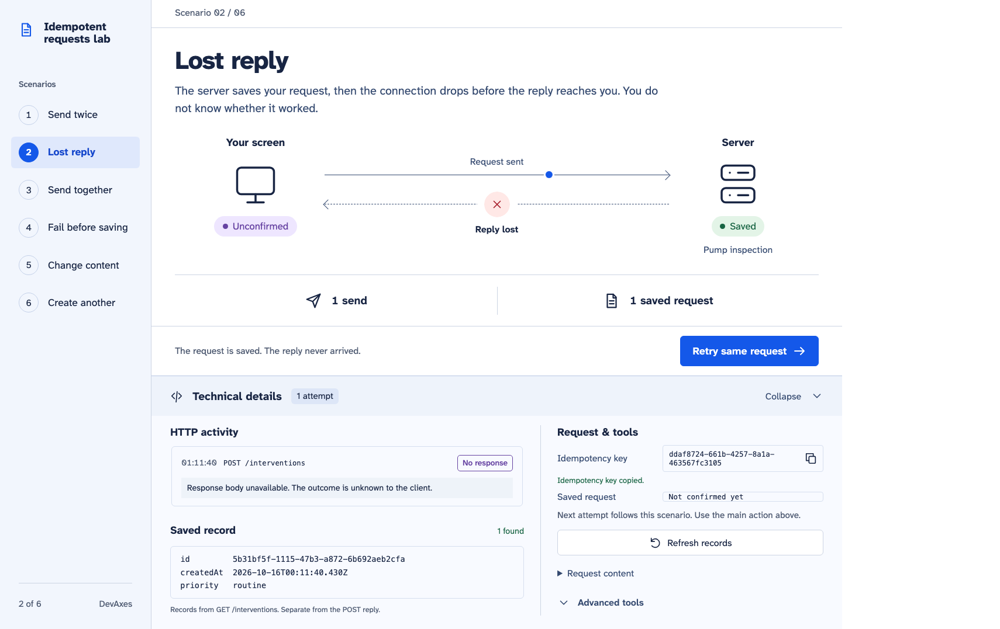
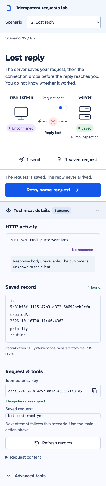
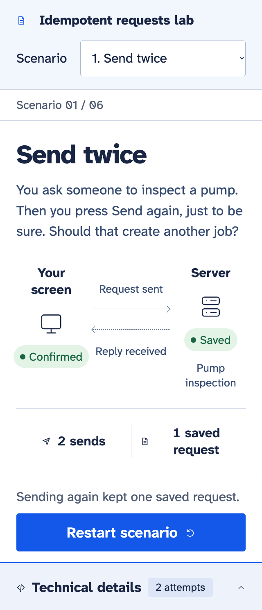

# Reproducible demonstration

Follow README.md setup, then run `LOCAL_DEMO=true pnpm dev`. Use fictional data only.
Choose a scenario in the left rail, or the scenario selector on narrow screens.
The bottom **Technical details** panel is collapsed by default.
Each send reaches the API; the saved-request list comes from PostgreSQL.

## Present the guided demonstration

Follow the numbered scenarios in order, or select one directly. Each page offers
one next action, with a short introduction directly beneath its title. Change scenarios
only in the navigation; the main button never advances to another scenario. No manual fault configuration is required.
The observer stage compares the client's confirmation with actual server records.

| Experiment         | First action              | Next action                 | Verified outcome                                       |
| ------------------ | ------------------------- | --------------------------- | ------------------------------------------------------ |
| Send twice         | Send the request          | Send the same request again | 2 sends, 1 saved request, same identifier              |
| Lost reply         | Send with a lost reply    | Retry same request          | Real post-commit response loss, then recovery          |
| Send together      | Send 20 attempts together | Review the result           | 20 actual calls, 1 saved request                       |
| Fail before saving | Try a send that fails     | Retry without the failure   | Zero rows after rollback, then one successful creation |
| Change content     | Save the routine request  | Try changing it to urgent   | 409 refusal; the original remains routine              |
| Create another     | Save the first request    | Create a separate request   | 2 keys, 2 records, identical business content          |

Every new experiment gets a unique fictional site reference. Only rows matching that
reference appear in the guided server observation; previous rows are kept and remain
visible under **Technical details → Advanced tools → All saved requests**. Counts and conclusions come from actual API/HTTP
activity. If the server cannot be read, the interface says so rather than displaying
zero or claiming success. Refresh the server evidence or inspect it before continuing.



Actual compiled-browser capture after the API socket was destroyed following commit.

## Reload, repeat and inspect

Reload after the unknown result. The selected experiment, request key, content and
retry stage are restored. Press Retry same request to confirm the saved job.
The equivalent HTTP experiment is `pnpm demo:cli`; it adds one fictional request.

Open **Technical details** to inspect the current scenario without leaving its page.
The key and HTTP attempts are preserved when collapsing the panel or reloading.
A missing POST reply does not confirm an identifier: the separate GET evidence can
still show the saved record. Copy buttons copy full identifiers.

The panel closes when switching scenarios. If the selected scenario has not started,
it names the preserved request and points back to the scenario navigation rather than
showing its evidence under the wrong scenario. Only one intention is active: starting another scenario replaces
it while preserving earlier database rows. URL fragments identify the selected scenario.

After completion, **Restart scenario** prepares a new run of the same scenario,
without sending anything or deleting rows. The selection also survives a reload.
An existing v0.1 browser session stays intact until a new experiment is started.

## Exchange animation

Each real send triggers a short outbound packet animation. The return path appears only
once the POST outcome is known: green for a confirmation, red for refusal or a retryable
failure, and purple stopping halfway for an unknown reply. Three staggered outbound dots
represent the batch of twenty concurrent attempts; the counter reports the real total.
These are explanatory illustrations, not measured network timing or packet tracing.
They do not establish that the server saved a request; that evidence comes from the separate GET.
Animations end without looping, do not replay on reload or scenario navigation, and do not
run for technical controls. Reduced-motion users retain the same static labels and counters.

## Technical controls

Expand **Advanced tools** inside the bottom panel for the manual form and local
controls. These operate on the current browser request and can change a guided result.
The fault selector applies only to manual sends; the main action follows its scenario.
Use **New request**
to create a new reference and unlock the content. To reproduce a manual conflict,
send normally, select Change content under the same key, then retry. The demo flips
priority rather than appending text beyond the input limit.

Purge and advancing time are separate controls. Advance clock by 25 hours, then Purge
eligible keys. Business records remain, but retrying a purged key may create again.
Reset lab data requires confirmation and deletes only rows in the isolated lab schema.
The controlled clock is process-local and survives a row reset, but not an API restart.
Normal and production mode hide/disable all fault controls at the API boundary.

## Automated evidence and visual conditions

The integration suite additionally tests two API instances, a process restart and a
750 ms concurrent lock timeout. Barrier hooks pause after writes before commit; a
separate connection verifies that neither row is visible. A contender is observed
waiting in pg_stat_activity before its 503 is checked. No fixed sleep alone establishes
the order of these fault tests.

Captures are from the real compiled app in Chromium: 1440×1024 and 1440×1100 desktop, 390×844 mobile,
659×853 (the observed in-app browser), and 640×800 with 200% root text size for reflow. The C comparison is also captured at the approved 1536×1024 dimensions. They use isolated test data. UUIDs and
times naturally differ across runs. See [verification.md](verification.md) for their
code revision and the recorded results. To regenerate after a code change:

```sh
pnpm build
CAPTURE_DOCS=true pnpm test:browser
```



Mobile capture of the expanded technical panel after a real lost response. The scan includes labels, contrast and landmarks.



200% text/reflow check. This is an automated layout surrogate; native browser zoom
and assistive-technology combinations can behave differently.
