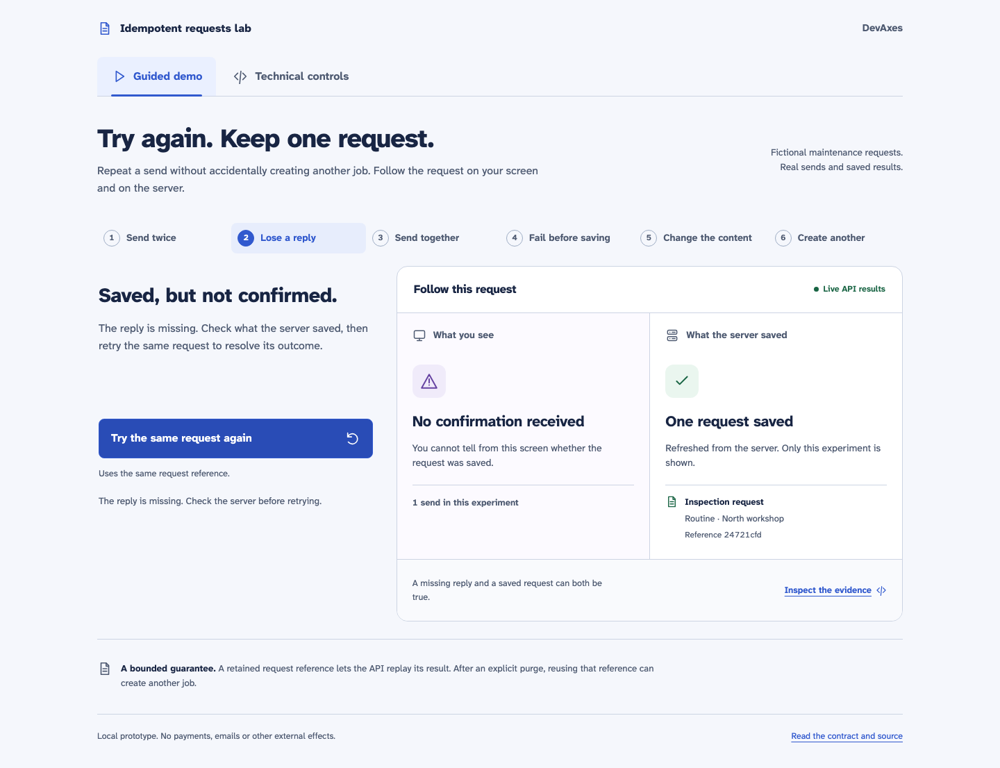
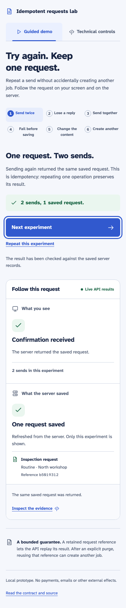
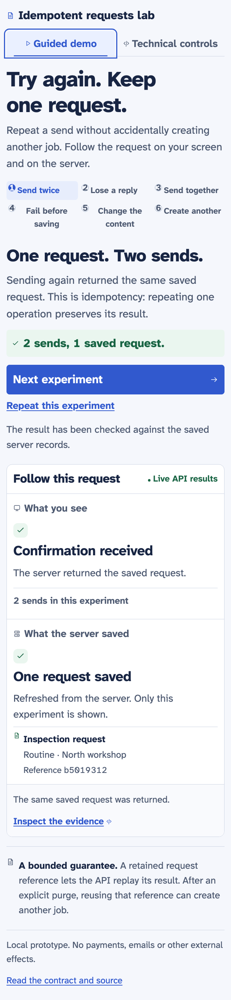

# Reproducible demonstration

Follow README.md setup, then run `LOCAL_DEMO=true pnpm dev`. Use fictional data only.
Choose Guided demo for the accompanied experiments, or Technical controls for the
manual form, request ledger and local fault tools.
Each send reaches the API; the saved-request list comes from PostgreSQL.

## Present the guided demonstration

Keep **Guided demo** selected. The lesson strip follows a useful teaching sequence,
and each scene offers one next action. No manual fault configuration is required.
The observer stage compares the client's confirmation with actual server records.

| Experiment         | First action              | Next action                 | Verified outcome                                       |
| ------------------ | ------------------------- | --------------------------- | ------------------------------------------------------ |
| Send twice         | Send the request          | Send the same request again | 2 sends, 1 saved request, same identifier              |
| Lose a reply       | Send with a lost reply    | Try the same request again  | Real post-commit response loss, then recovery          |
| Send together      | Send 20 attempts together | Review the result           | 20 actual calls, 1 saved request                       |
| Fail before saving | Try a send that fails     | Retry without the failure   | Zero rows after rollback, then one successful creation |
| Change the content | Save the routine request  | Try changing it to urgent   | 409 refusal; the original remains routine              |
| Create another     | Save the first request    | Create a separate request   | 2 keys, 2 records, identical business content          |

Every new experiment gets a unique fictional site reference. Only rows matching that
reference appear in the guided server observation; previous rows are kept and remain
visible under Technical controls. Counts and conclusions come from actual API/HTTP
activity. If the server cannot be read, the interface says so rather than displaying
zero or claiming success. Refresh the server evidence or inspect it before continuing.



Actual compiled-browser capture after the API socket was destroyed following commit.

## Reload, repeat and inspect

Reload after the unknown result. The selected experiment, request key, content and
retry stage are restored. Press Try the same request again to confirm the saved job.
The equivalent HTTP experiment is `pnpm demo:cli`; it adds one fictional request.

Use **Inspect the evidence** to open the Technical controls tab. The current key,
business identifier and HTTP attempts are preserved when switching between tabs.
**Repeat this experiment** starts another explicit experiment without deleting rows.
An existing v0.1 browser session stays intact until a new experiment is started.

## Technical controls

The second tab retains the full manual form and every local control. Use **New request**
to create a new reference and unlock the content. To reproduce a manual conflict,
send normally, select Change content under the same key, then retry. The demo flips
priority rather than appending text beyond the input limit.

Purge and advancing time are separate controls. Advance clock by 25 hours, then Purge
eligible keys. Business records remain, but retrying a purged key may create again.
Reset lab data requires confirmation and deletes only rows in the isolated lab schema.
The controlled clock is process-local and survives a row reset, but not an API restart.
Normal and production mode hide/disable all fault controls at the API boundary.

## Automated evidence and visual conditions

The integration suite additionally tests two API instances, a process restart and a
750 ms concurrent lock timeout. Barrier hooks pause after writes before commit; a
separate connection verifies that neither row is visible. A contender is observed
waiting in pg_stat_activity before its 503 is checked. No fixed sleep alone establishes
the order of these fault tests.

Captures are from the real compiled app in Chromium: 1440×1100 desktop, 390×844 mobile,
659×853 (the observed in-app browser), and 640×800 with 200% root text size for reflow. They use isolated test data. UUIDs and
times naturally differ across runs. See [verification.md](verification.md) for their
code revision and the recorded results. To regenerate after a code change:

```sh
pnpm build
CAPTURE_DOCS=true pnpm test:browser
```



Mobile capture after a keyboard-only send. The scan includes labels, contrast and landmarks.



200% text/reflow check. This is an automated layout surrogate; native browser zoom
and assistive-technology combinations can behave differently.
