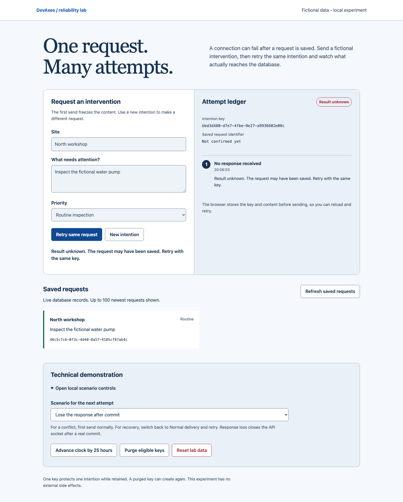
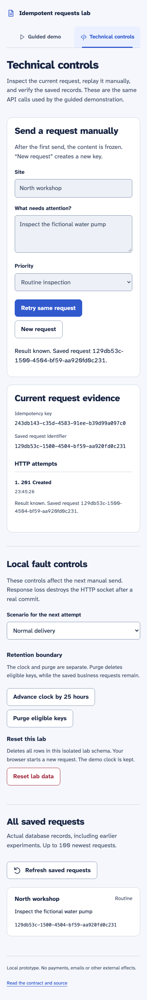
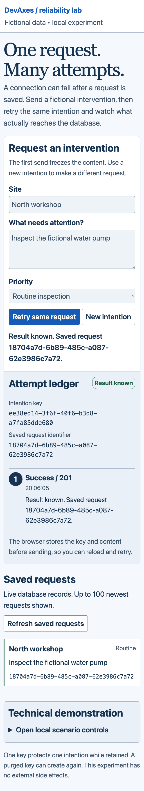

# Reproducible demonstration

Follow README.md setup, then run `LOCAL_DEMO=true pnpm dev`. Use fictional data only.
The two visible areas separate the user's form/ledger from local technical controls.
Each send reaches the API; the saved-request list comes from PostgreSQL.

## Lost response and recovery

1. Confirm the form shows North workshop, the fictional water pump and Routine inspection.
2. Open local scenario controls; select Lose the response after commit.
3. Send. PostgreSQL commits the business request and stored response; the API then
   destroys its HTTP socket. The proxy may return a 500 without a usable body.
4. Observe Result unknown and exactly one new saved record. Record the intention key.
5. Reload. The same key and frozen content are restored; the scenario defaults to Normal delivery.
6. Retry. The result becomes known with the identifier already present in the database.
7. Retry again: the status is still 201 and no extra record appears.

The equivalent HTTP experiment is `pnpm demo:cli`. The integration test compares
replayed JSON with the response stored in the database, not just identifiers.



Actual browser capture: the response is missing, while the record below proves commit.

## Other scenarios

Use New intention before a scenario that requires a new key. This keeps the same default
content, creates a different key and unlocks the form.

| Scenario           | Procedure                                               | Observed effect                                                 |
| ------------------ | ------------------------------------------------------- | --------------------------------------------------------------- |
| Rollback           | New intention; Fail before commit; send                 | 503 and no new row; Normal delivery + retry creates one         |
| Concurrency        | New intention; Send 20 simultaneous attempts            | 20 ledger entries and one saved request                         |
| Conflict           | Send normally; Change content under the same key; retry | Demo flips priority, producing 409 and no duplicate             |
| Distinct intention | New intention; normal send with identical content       | A second record with a new identifier                           |
| Retention          | Purge before advancing clock                            | Zero newly eligible keys purged                                 |
| Purge boundary     | Advance 25 hours; purge; retry an old key               | Business rows remain; the purged key can create another request |
| Reset              | Reset lab data; confirm                                 | Only the lab schema's business/key rows are cleared             |

The controlled demo clock is process-local; restarting restores real wall time. Reset
clears rows, not the clock. Restart the API if you want a fresh clock.

## Automated evidence and visual conditions

The integration suite additionally tests two API instances, a process restart and a
750 ms concurrent lock timeout. Barrier hooks pause after writes before commit; a
separate connection verifies that neither row is visible. A contender is observed
waiting in pg_stat_activity before its 503 is checked. No fixed sleep alone establishes
the order of these fault tests.

Captures are from the real compiled app in Chromium: 1440×1100 desktop, 390×844 mobile,
and 640×800 with 200% root text size for reflow. They use isolated test data. UUIDs and
times naturally differ across runs. See [verification.md](verification.md) for their
code revision and the recorded results. To regenerate after a code change:

```sh
pnpm build
CAPTURE_DOCS=true pnpm test:browser
```



Mobile capture after a keyboard-only send. The scan includes labels, contrast and landmarks.



200% text/reflow check. This is an automated layout surrogate; native browser zoom
and assistive-technology combinations can behave differently.
