# A visual tour of the lab

The lab asks a small question: if an app sends the same request again, should the
server create another job? These are captures of the compiled **v0.3.1** interface,
not mockups. Each result below came from real HTTP calls and PostgreSQL records in
an isolated capture schema. The [capture manifest](visuals/manifest.json) records
the source revision, browser, viewport and observed outcomes for every image.

## Start with one action

Choose a scenario on the left. Its introduction explains the situation, the middle
compares **Your screen** with **Server**, and the bottom offers the next action.
**Technical details** starts collapsed. Narrow screens use a scenario selector.

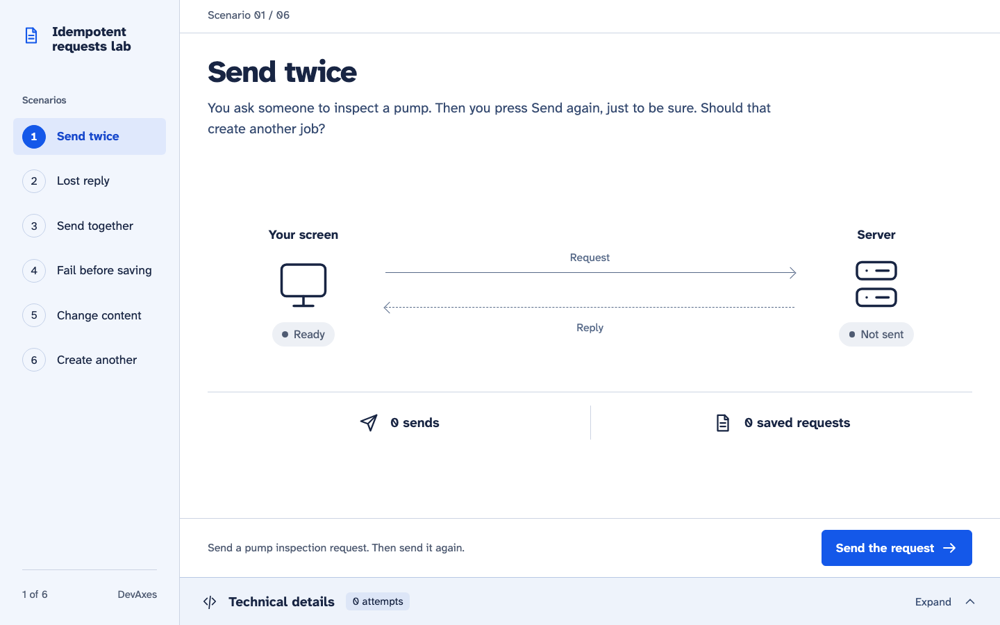

Only the navigation changes scenarios. After completion, **Restart scenario**
prepares another run of the same scenario. It does not send a request or delete
previous server records.

## 1. Send twice

Send the pump inspection request, then send it again. Both replies confirm the same
saved job: **2 sends, 1 saved request**. The same reference and content recover the
recorded result.

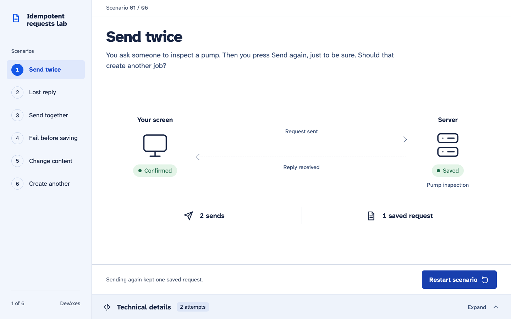

## 2. Lose a reply, then recover

The API saves the request and deliberately closes the connection before its reply
reaches the app. The screen is **Unconfirmed**, but the separate server observation
shows one saved request. A missing confirmation leaves the user uncertain.

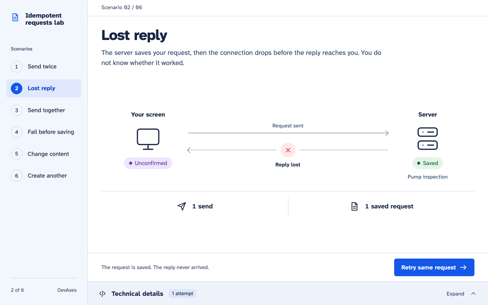

Retry the same request. The screen becomes **Confirmed** and the count stays at one
saved job. Open the technical panel to compare the recovered identifier.

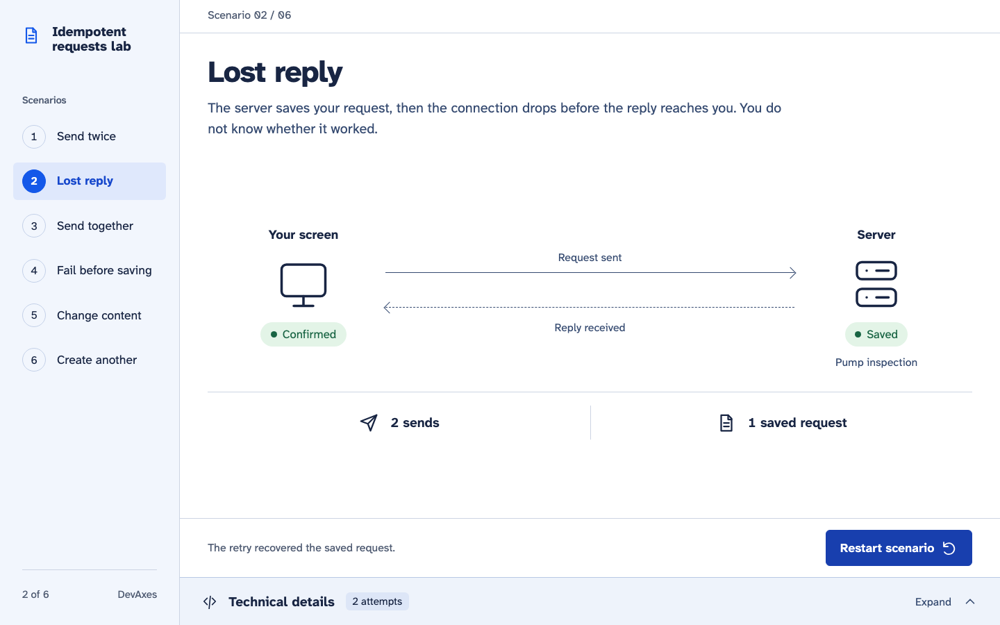

<details>
<summary>Watch the real request and reply animation</summary>

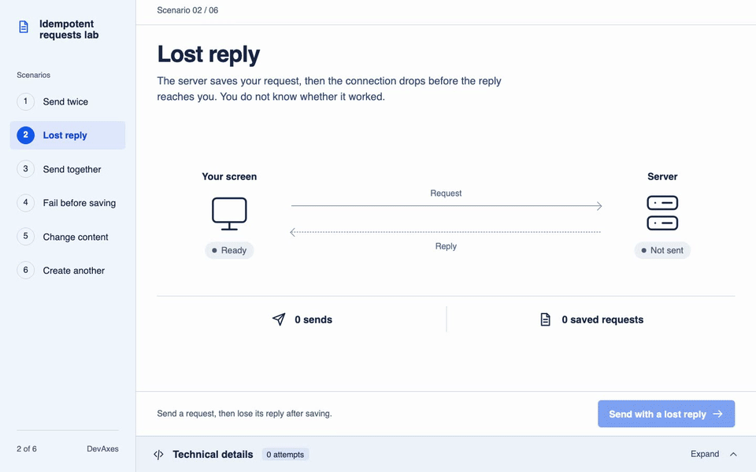

This recording keeps the app's normal animations and real replies. The moving dots
illustrate the exchange; their travel time is not measured network latency. The
recording is encoded at 12 frames per second and 960px wide, with playback speed
preserved. Static screenshots use reduced motion so packets do not obscure results.

</details>

## 3. Send twenty attempts together

The action makes twenty actual calls with the same reference. All twenty return the
accepted result; PostgreSQL stores one request. A disabled button alone cannot
coordinate independent callers.

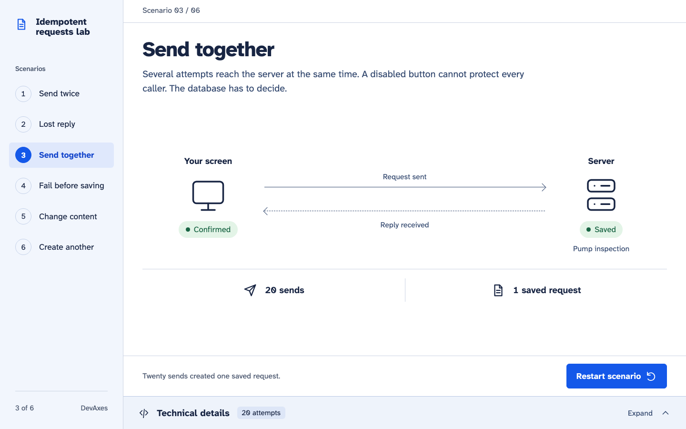

## 4. Fail before saving

The injected failure happens before commit. The first attempt leaves **0 saved
requests**; a retry with the same reference succeeds. The transaction keeps the
request and its replay result together.

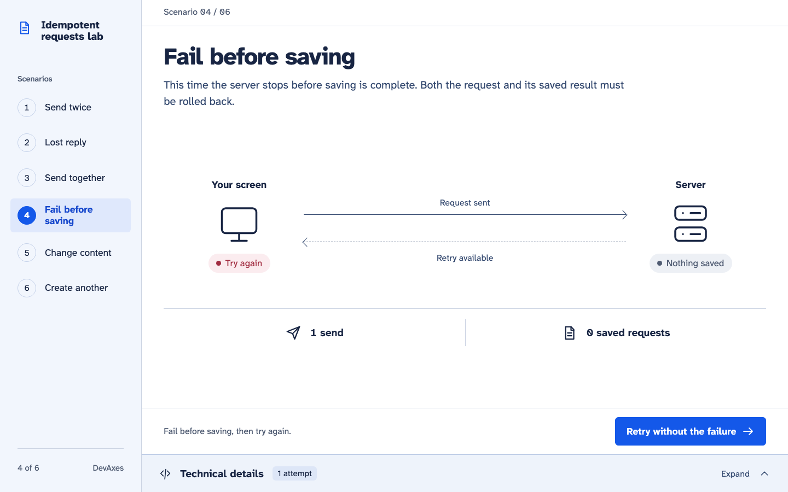

[See the successful retry: two sends, one saved request](visuals/recovered-failure.png).

## 5. Change the content under the same reference

Save a routine inspection, then try to change its priority to urgent using the same
reference. The server refuses the second attempt with 409. The original remains
routine; the interface describes the refusal rather than claiming a replay.

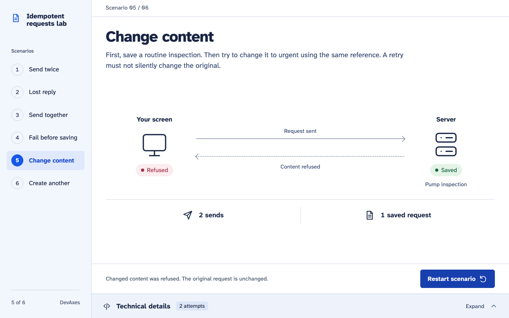

## 6. Create a separate request

Use a new reference for a second inspection with identical content. This is a new
intention: **2 sends, 2 saved requests**. The API does not infer intention from
similar content.

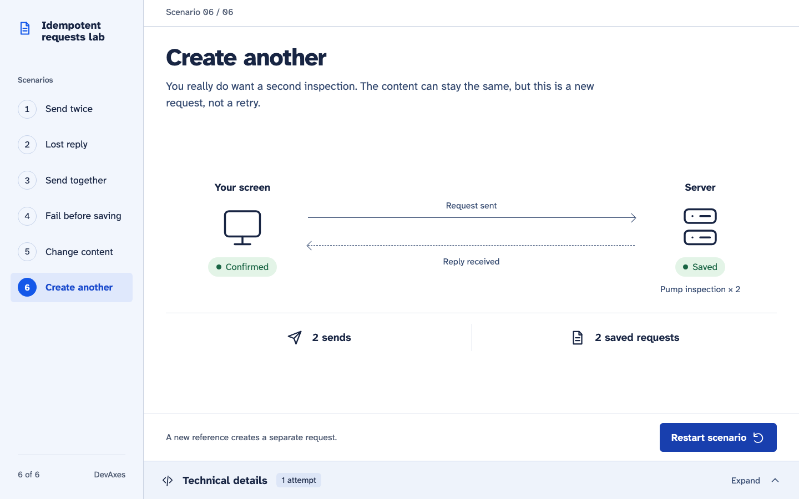

## Inspect the evidence in place

Expand **Technical details** beneath any scenario. HTTP activity describes what the
client received; **Saved record** lists observations from the independent GET.
After a lost reply, the panel can show a saved record while the POST identifier is
still **Not confirmed yet**. Copy controls preserve complete identifiers.

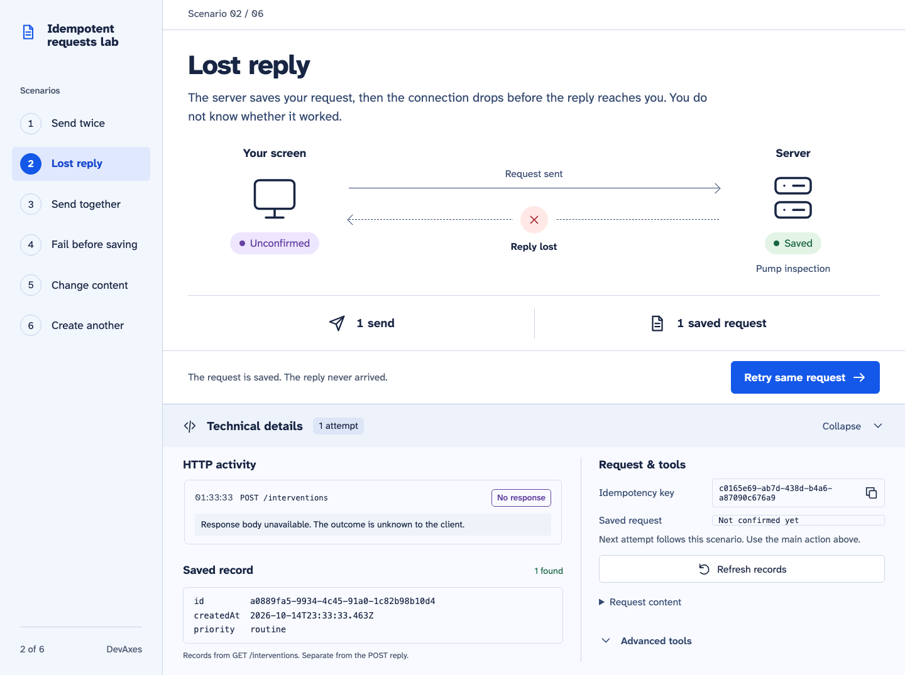

**Advanced tools** contains manual sends, fault controls, the retention clock,
explicit purge and confirmed reset. These can affect the current experiment; they
are explained in the [demo protocol](demo.md#technical-controls).

<details>
<summary>See the narrow-screen scenario and technical panel</summary>

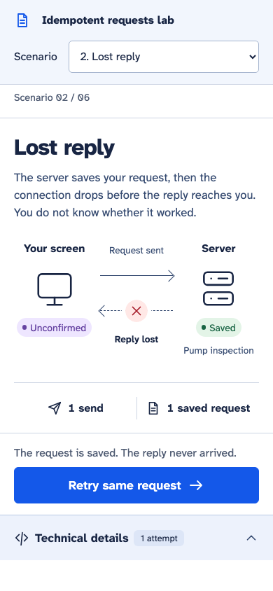

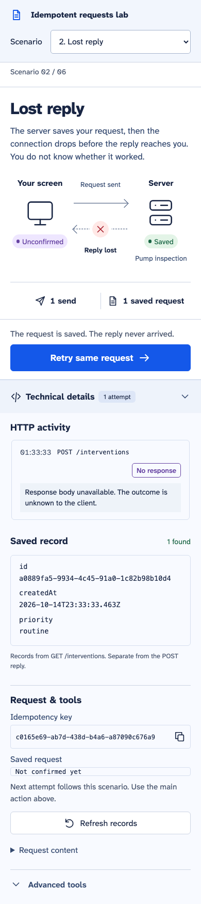

</details>

## Reproduce these visuals

From a configured clone, with Docker PostgreSQL running and Chromium installed:

```sh
pnpm docs:capture
```

The command builds the app, then starts Vite preview and a separate API on ports
5174 and 3101. It creates, resets and finally drops its own PostgreSQL schema. It
never opens or resets the running demo on ports 5173 and 3100. Do not run it alongside
`pnpm test:browser`, which reserves the same capture/test ports.

It checks the actual send count and saved rows before each PNG, waits for the local
font, disables decorative motion, checks horizontal overflow and embeds source
provenance as PNG metadata. It refreshes `docs/visuals/manifest.json`. UUIDs and
timestamps vary between runs. These assertions support the captures; the full
regression suite remains `pnpm check`.

To regenerate the optional GIF as well, install FFmpeg separately and run:

```sh
CAPTURE_GIF=true pnpm docs:capture
```

The unencoded browser recording stays under ignored `test-results/visual-recording/`.
Without that option, an existing GIF and its recorded provenance are preserved.
The manifest distinguishes static captures from the normal-motion recording.
Earlier milestone screenshots remain under `docs/evidence/`; they are historical
verification assets and are not overwritten by this command.
